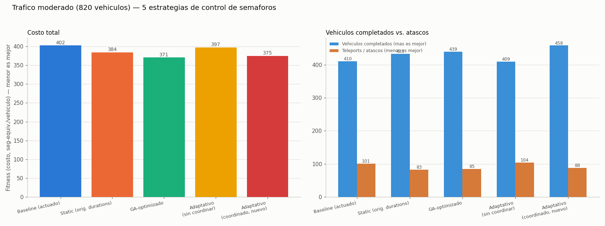
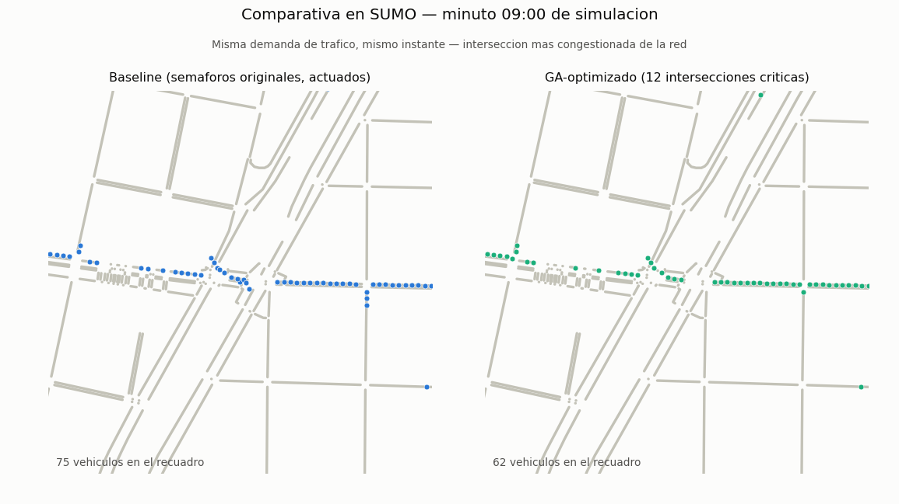
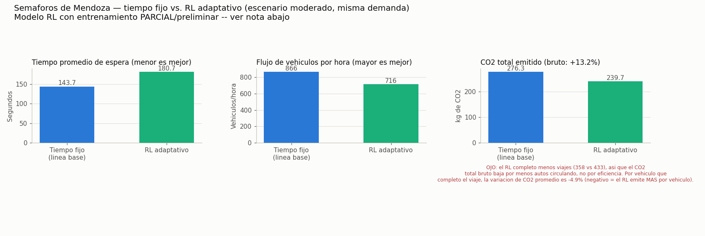

# Optimización de la Red Semafórica Urbana mediante Inteligencia Artificial — Ciudad de Mendoza

**Universidad del Aconcagua · CACIC 2026 (Grupo 9)**  
**Autores:** Gerónimo Torres, Valentino Cutrera, Francisco Segui, Juan Jorge, Tobías Funes  
**Director:** Miguel Mendez Garabetti

---

## Descripción General del Proyecto

Este repositorio contiene el entorno de simulación, los algoritmos de optimización y control inteligente, los modelos entrenados, los datos experimentales y el informe completo (`Investigacion_IA_Semaforos_Mendoza.docx`) del proyecto de investigación sobre **gestión adaptativa y eficiente del tráfico urbano en la ciudad de Mendoza** utilizando **Eclipse SUMO (Simulation of Urban MObility)** e **Inteligencia Artificial**.

El objetivo central es evaluar en qué medida distintas técnicas de IA y control adaptativo permiten reducir la congestión vehicular, los tiempos de espera, los atascos (*teleports*) y las emisiones contaminantes ($\text{CO}_2$) frente a los esquemas tradicionales de semáforos de tiempo fijo.

### Evolución y Escalado del Proyecto (`delivery_791`)

El proyecto aborda dos escalas de red sobre mapas reales de Mendoza extraídos de OpenStreetMap (OSM):

1. **Escenario Céntrico Base (63 semáforos / 12 intersecciones críticas):**
   - Optimización sobre las **12 intersecciones de mayor congestión acumulada** (`scope_tls_top12.json`), identificadas mediante ranking de colas (`find_critical_tls.py`).
   - Demanda sintética moderada (**820 vehículos** en 30 minutos) y densa (**1.800 vehículos** en 30 minutos).
   - Evaluación completa de 5 enfoques: *Baseline actuado*, *Tiempo fijo (Static)*, *Algoritmo Genético (GA)*, *Control Adaptativo Max-Pressure (con y sin coordinación vecinal)* y *Aprendizaje por Refuerzo (DQN uni-agente y PPO multi-agente)*.

2. **Reescalado a Gran Mendoza (`delivery_791` — 791 semáforos):**
   - Expansión de la red vial (`osm.net.xml.gz`, ~250 MB descomprimida) abarcando **791 intersecciones semaforizadas** (`scope_tls_791.json`, equivalente a **1.726 fases verdes / genes**).
   - Demanda vehicular reescalada a **10.286 vehículos** (`osm.rou.xml`).
   - Generación automatizada de topología de carriles controlados (`build_controlled_lanes.py` → `tls_controlled_lanes.json`) y grafo de vecindad aguas arriba/abajo (`tls_topology.py` → `tls_downstream_lanes.json`, `tls_adjacency.json`) para los 791 semáforos.
   - Evaluación paralelizada multiproceso en `ga_run.py` (`multiprocessing.Pool`) para distribuir las simulaciones de SUMO entre todos los núcleos de CPU disponibles.

---

## Arquitectura y Estrategias de Control Evaluadas

El sistema se estructura en **4 capas** (Captura de datos en tiempo real vía TraCI → Procesamiento de colas/ocupación → Decisión mediante IA/heurística → Ejecución sobre fases de `tlLogic`):

| Estrategia | Script Principal | Descripción Técnica |
|---|---|---|
| **1. Tiempo Fijo (Línea Base)** | `baseline_fixed_run.py` | Congela los semáforos en `type="static"` conservando sus duraciones originales de OSM. Activa el modelo de emisiones **HBEFA** de SUMO (`--device.emissions.probability 1.0`). |
| **2. Algoritmo Genético (GA)** | `ga_run.py` / `ga_lib.py` | Metaheurística offline que evoluciona un genoma con las duraciones de fase verde ($[8\text{ s}, 70\text{ s}]$) mediante selección por torneo, cruce aritmético, mutación gaussiana y elitismo. |
| **3. Adaptativo sin Coordinar** | `adaptive_run.py --no-coord` | Controlador en tiempo real (*max-pressure / gap-out*) que decide cada segundo vía TraCI extender o cortar la fase verde según la cola local de cada esquina aislada. |
| **4. Adaptativo Coordinado (Presión Neta)** | `adaptive_run.py` / `adaptive_lib.py` | Variante *spillback-aware max-pressure* (Varaiya, 2013): descuenta de la presión local la ocupación de los carriles aguas abajo (`tls_downstream_lanes.json`) y corta el verde al cumplir `MIN_GREEN` si la cuadra de salida supera el 80% de ocupación (`SPILLBACK_OCC`), evitando trasladar el atasco al semáforo vecino. |
| **5. RL Uni-Agente (DQN)** | `train_rl.py` / `sumo_rl_env.py` | Agente *Deep Q-Network* (Stable-Baselines3) sobre la intersección crítica `1135888071` con espacio de observación de 5 variables (incluyendo ocupación aguas abajo). |
| **6. RL Multi-Agente Centralizado (PPO)** | `train_rl_multi.py` / `sumo_rl_multiagent_env.py` | Política única *Proximal Policy Optimization* con acción conjunta `MultiDiscrete([2]*12)` sobre las 12 intersecciones críticas. Observa 60 variables ($5 \times 12$: colas locales, tiempo en fase, ocupación aguas abajo y cola máxima de vecinos directos en `tls_adjacency.json`) con recompensa global compartida a nivel red. |

### Función de Costo (Fitness)

Para evaluar cada plan o política se utiliza el costo compuesto por vehículo en segundos equivalentes (`ga_lib.py`):

$$\text{Fitness} = \overline{\text{TimeLoss}}_{\text{completados}} + 600 \cdot \frac{N_{\text{no completados}}}{N_{\text{cargados}}} + 30 \cdot \frac{N_{\text{teleports}}}{N_{\text{cargados}}}$$

Adicionalmente, `ga_lib.compute_full_metrics()` calcula las tres métricas clave de comparación final:
1. **Tiempo promedio de espera** (`waitingTime`, en segundos).
2. **Flujo vehicular horario** (vehículos que completan su viaje por hora simulada).
3. **Emisiones de $\text{CO}_2$** (total en kg y promedio en gramos por vehículo completado, según modelo HBEFA).

---

## Resultados Experimentales

### 1. Comparación de las 5 Estrategias y Efecto de la Coordinación Vecinal (Escenario Moderado — 820 vehículos)



| Escenario | Fitness (menor es mejor) | Vehículos Completados (/820) | Teleports (Atascos) | Tiempo Medio de Espera |
|---|---:|---:|---:|---:|
| **Baseline (actuado original)** | 402,36 | 410 | 101 | 156,3 s |
| **Tiempo Fijo (Static original)** | 384,40 | 433 | 83 | 143,7 s |
| **GA-Optimizado (offline)** | **370,74** | 439 | 85 | **125,2 s** |
| **Adaptativo (sin coordinar)** | 397,43 | 409 | 104 | — |
| **Adaptativo (coordinado — presión neta)** | **374,92** | **458** | **88** | — |

> **Hallazgo clave:** Al incorporar coordinación aguas abajo (*presión neta*), el controlador adaptativo en tiempo real incrementa en un **+12,0%** los viajes completados (de 409 a 458 vehículos, superando incluso al GA y al tiempo fijo) y reduce en un **-15,4%** los atascos severos (*teleports*, de 104 a 88).



---

### 2. Comparación Final: Tiempo Fijo vs. RL Multi-Agente (PPO)

El agente PPO multi-agente fue entrenado inicialmente a 10.000 pasos y luego extendido hasta **50.880 pasos** (`rl_multi_model_final.zip`) en tandas incrementales con `--resume`.



| Métrica | RL @ 10.000 pasos | RL @ 50.880 pasos | Tiempo Fijo (Línea Base) | Variación (RL 50k vs. Fijo) |
|---|---:|---:|---:|---:|
| **Tiempo promedio de espera** | 220,9 s | 180,7 s | **143,7 s** | +25,7% |
| **Flujo vehicular** | 592 veh/h | 716 veh/h | **866 veh/h** | -17,3% |
| **Vehículos completados** | 296 / 820 | 358 / 820 | **433 / 820** | -17,3% |
| **Teleports (autos atascados)** | 220 | 161 | **83** | +94,0% |
| **$\text{CO}_2$ por vehículo completado** | 701,4 g | 669,7 g | **638,1 g** | +4,9% |
| **$\text{CO}_2$ total bruto emitido** | — | 239,7 kg | 276,3 kg | -13,2% *(por menor flujo)* |

**Análisis técnico:** El entrenamiento extendido de 10k a 50,8k pasos produjo mejoras consistentes en todas las métricas del agente RL (-18,2% en espera, +20,9% en flujo, -26,8% en atascos y -4,5% en $\text{CO}_2$/vehículo). Sin embargo, debido a la alta dimensionalidad del espacio de acción conjunto ($2^{12} = 4096$ combinaciones posibles en `MultiDiscrete`) con una única política centralizada PPO (`n_steps=256`), con 50.000 pasos aún no supera a la línea base de tiempo fijo. Como trabajo futuro se plantea descentralizar la política (un agente por intersección con MARL/PettingZoo) y extender el entrenamiento a 150k–200k pasos.

---

## Estructura del Repositorio

Todos los archivos del paquete se encuentran en la carpeta [`delivery_791/`](./delivery_791):

### Red Vial, Demanda y Configuración SUMO
- `osm.net.xml.gz` — Red vial completa de SUMO para el Gran Mendoza (**791 semáforos**, ~28 MB comprimida / ~250 MB descomprimida). *Nota: `ga_lib.py` descomprime automáticamente este archivo a `osm.net.xml` la primera vez que se ejecuta cualquier script.*
- `osm.poly.xml` — Polígonos y edificaciones para visualización en `sumo-gui`.
- `osm.rou.xml` — Demanda vehicular moderada reescalada para los 791 semáforos (**10.286 vehículos**, 30 min).
- `osm_denso.rou.xml` — Escenario de demanda densa (1.800 vehículos).
- `sim.sumocfg` — Archivo de configuración principal para abrir la simulación en `sumo` o `sumo-gui`.
- `net_best.xml` / `net_best.xml.gz` / `net_best_denso.xml` — Redes viales con los planes de tiempos ya optimizados por el Algoritmo Genético.

### Topología y Scopes de Semáforos
- `scope_tls_791.json` — Lista de IDs de los **791 semáforos** de la red reescalada (usado por defecto en `ga_lib.load_scope()`).
- `scope_tls_top12.json` — Subconjunto de las **12 intersecciones críticas** originales (usado en los entrenamientos multi-agente y comparativas base).
- `scope_tls_denso.json` / `scope_tls.json` / `top_tls.json` — Rankings de intersecciones por congestión acumulada.
- `build_controlled_lanes.py` — Script que interroga a SUMO vía TraCI para generar `tls_controlled_lanes.json` para cualquier red y scope.
- `tls_topology.py` — Calcula con `sumolib` los carriles aguas abajo (`tls_downstream_lanes.json`) y la adyacencia directa entre semáforos (`tls_adjacency.json`).
- `find_critical_tls.py` — Ejecuta una simulación base con `--queue-output` y genera el ranking de intersecciones más congestionadas.

### Algoritmos de Optimización y Control
- `ga_lib.py` — Librería base: parseo y reconstrucción rápida de `<tlLogic>` en `net.xml`, ejecución headless de SUMO y cálculo de fitness y métricas con emisiones HBEFA (`compute_full_metrics`).
- `ga_run.py` — Algoritmo Genético paralelizado con `multiprocessing.Pool` (`POP_SIZE=8`, `N_GEN=8`, `LOADED_VEHICLES=10286`).
- `adaptive_lib.py` / `adaptive_run.py` — Controlador adaptativo en tiempo real *max-pressure / gap-out* con soporte para coordinación por presión neta y prevención de *spillback*.
- `baseline_fixed_run.py` — Evaluación del escenario base de tiempo fijo con métricas completas y emisiones de $\text{CO}_2$.
- `sumo_rl_env.py` / `train_rl.py` — Entorno Gymnasium y entrenamiento DQN para un semáforo individual (`rl_model_final.zip`, checkpoints en `rl_checkpoints/`).
- `sumo_rl_multiagent_env.py` / `train_rl_multi.py` / `eval_rl_multi.py` — Entorno Gymnasium multi-agente, entrenamiento PPO con soporte `--resume` y evaluación determinista (`rl_multi_model_final.zip`).

### Resultados, Gráficos y Documentación
- `Investigacion_IA_Semaforos_Mendoza.docx` — Informe completo de la investigación.
- `gamma_exposicion_cacic.md` — Guion y estructura de diapositivas para la presentación en CACIC 2026.
- `result_*.json`, `comparison.json`, `timing_table.json`, `best_genome_denso.json`, `ga_log_denso.jsonl`, `rl_train_log.csv`, `rl_multi_train_log.csv` — Logs y resultados numéricos de todas las corridas.
- `make_charts.py`, `make_adaptive_chart.py`, `make_comparison_coord_chart.py`, `make_final_comparison_chart.py`, `make_comparison_gif.py` — Scripts reproductibles para generar todos los gráficos (`.png`) y la animación comparativa (`comparativa_sumo.gif`).

---

## Requisitos e Instalación

1. **Python 3.9+** y **Eclipse SUMO (1.27.1)**:
   ```bash
   pip install eclipse-sumo gymnasium stable-baselines3 matplotlib numpy
   ```
2. Configurar las variables de entorno de SUMO:
   - **Linux / macOS (bash):**
     ```bash
     export SUMO_HOME=$(python3 -c "import sumo,os; print(os.path.dirname(sumo.__file__))")
     export PATH=$SUMO_HOME/bin:$PATH
     export PYTHONPATH=$SUMO_HOME/tools:$PYTHONPATH
     ```
   - **Windows (PowerShell):**
     ```powershell
     $env:SUMO_HOME = (python -c "import sumo,os; print(os.path.dirname(sumo.__file__))")
     $env:PATH = "$env:SUMO_HOME\bin;$env:PATH"
     $env:PYTHONPATH = "$env:SUMO_HOME\tools;$env:PYTHONPATH"
     ```

---

## Cómo Ejecutar los Experimentos

Ubicarse dentro de la carpeta `delivery_791`:

```bash
cd delivery_791
```

> Al ejecutar cualquier script por primera vez, `ga_lib.py` descomprimirá automáticamente `osm.net.xml.gz` en `osm.net.xml` (~250 MB).

### 1. Reconstruir topología de semáforos (opcional, ya generada en los `.json`)
```bash
python build_controlled_lanes.py osm.net.xml scope_tls_791.json tls_controlled_lanes.json
python tls_topology.py
```

### 2. Correr el Algoritmo Genético (en paralelo)
```bash
python ga_run.py
```
> *Nota de memoria:* Cada worker paralelo de SUMO consume ~2,8 GB de RAM en la red de 791 semáforos. Podés ajustar `NUM_WORKERS` en `ga_run.py` según la RAM disponible en tu equipo.

### 3. Correr el Controlador Adaptativo (sin coordinar vs. coordinado)
```bash
python adaptive_run.py osm.rou.xml moderado_nocoord 820 --no-coord
python adaptive_run.py osm.rou.xml moderado_coord 820
python make_comparison_coord_chart.py
```

### 4. Evaluar Tiempo Fijo vs. RL Multi-Agente (PPO) y generar gráfico final
```bash
python baseline_fixed_run.py osm.rou.xml moderado 820
python eval_rl_multi.py osm.rou.xml moderado 820
python make_final_comparison_chart.py moderado
```

### 5. Continuar el entrenamiento del agente RL Multi-Agente
```bash
python train_rl_multi.py 5000 --resume
```

### 6. Visualizar la simulación en la interfaz gráfica de SUMO
```bash
sumo-gui -n net_best.xml -r osm.rou.xml
```

